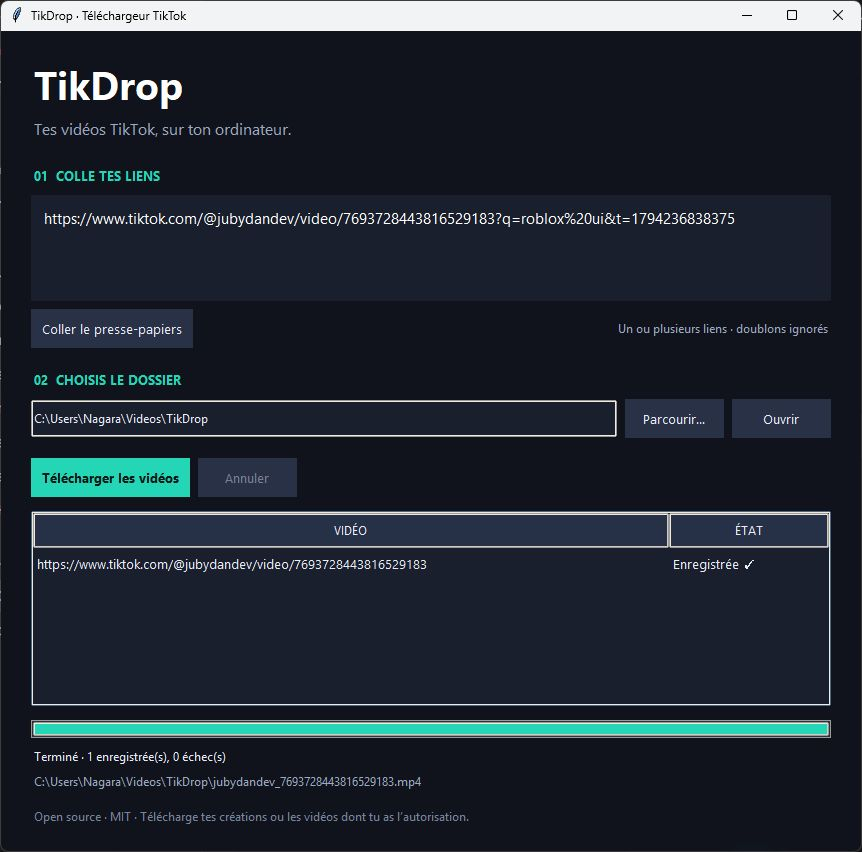

<div align="center">

# TikDrop

### Your TikTok videos, on your computer.

A small, free and open source Windows app.<br>
Paste your links. Pick a folder. Download your videos.

[](https://github.com/Nagaraaa/TikDrop/releases/latest)
[](#installation)
[](LICENSE)
[](#run-from-source)

[Français](README.md) · **English**

**[Download for Windows](https://github.com/Nagaraaa/TikDrop/releases/latest/download/TikDrop-Windows.zip)** · [All releases](https://github.com/Nagaraaa/TikDrop/releases)



*Actual application screenshot after a successful download. The current app interface is in French.*

</div>

## Why TikDrop?

| Feature | What you can do |
| --- | --- |
| **Simple** | Paste a TikTok link or the full text of a shared post. Links that are not videos are skipped. |
| **Clipboard** | TikDrop spots a copied TikTok link and offers to add it. |
| **Multiple videos** | Add several links and download them one after another. |
| **Your folder** | Choose where to save your videos; TikDrop remembers it. |
| **Live feedback** | See the creator, title, progress, speed and time left for each video. |
| **Clear errors** | Understand why a video failed, then retry only the failed ones. |
| **Resume** | Retry partial downloads without overwriting existing files. |
| **Portable** | Use the Windows build without installing Python or FFmpeg. |

No ads, added telemetry or API key required. TikDrop does not ask for your password or access to your browser cookies. Downloads use the open source [yt-dlp](https://github.com/yt-dlp/yt-dlp) engine.

## Installation

### Windows — the easiest way

**64-bit Windows build, tested on Windows 11.** An Internet connection is required.

1. Download **[TikDrop-Windows.zip](https://github.com/Nagaraaa/TikDrop/releases/latest/download/TikDrop-Windows.zip)**.
2. Right-click the archive and select **Extract All…**.
3. Open the extracted **TikDrop** folder.
4. Double-click **TikDrop.exe**.

You are ready to go: no terminal commands or Python installation needed.

> **Keep the entire folder.** The `_internal` folder must stay next to `TikDrop.exe`. Do not run the app from inside the ZIP. The executable in this first release is not digitally signed.

```text
TikDrop/
├── TikDrop.exe       ← run this file
├── _internal/        ← required to run the app
├── licenses/
└── README.md
```

## How to use

The current interface is in French. These are the steps and labels you will see:

1. On TikTok, copy a video's link using **Share → Copy link**.
2. Back in TikDrop, click **Ajouter** (Add) in the green banner, click **Coller** (Paste), or paste directly.
3. To download several videos, add one link per line.
4. Click **Changer…** (Change) to choose your destination folder; it is remembered.
5. Click **Télécharger** (Download) or press Ctrl+Enter, then wait for **Enregistrée ✓** (Saved).
6. Click **Afficher** (Show) next to a video, or **Ouvrir** (Open), to find your files.

**Annuler** (Cancel) stops the current batch; **Réessayer** (Retry) only reruns failed or cancelled videos. A `.part` file may remain in the folder: retrying can resume it, or you can delete it.

### Supported links

```text
https://www.tiktok.com/@creator/video/1234567890123456789
https://vm.tiktok.com/…
https://vt.tiktok.com/…
https://www.tiktok.com/t/…
```

These addresses illustrate supported formats: use your video's actual link. Sharing parameters are removed and identical links are deduplicated. Filenames include the creator's name and video ID.

## Troubleshooting

| Problem | What to do |
| --- | --- |
| The app will not open, or reports a missing file | Extract the **entire** archive and keep `_internal` next to the executable. |
| A link is rejected | Use an individual video link, rather than a profile or live stream. |
| “IP blocked”, “403” or login required | Check that the video is public and accessible in your browser. Retry later and check for newer TikDrop releases. Access is not guaranteed on every network. |
| There is a `.part` file | The download was interrupted. Retry with the same folder to attempt a resume. |
| An existing video is not replaced | This is intentional: existing files are not overwritten. |

Still having trouble? Click **Copier l’erreur** (copy error) next to the failed video, then [open an issue](https://github.com/Nagaraaa/TikDrop/issues) and paste the text: it contains the TikDrop, yt-dlp and Windows versions, the link and the technical details. Failures are also logged in `%APPDATA%\TikDrop\tikdrop.log`. Do not post passwords, cookies or private information.

## Run from source

**Requirements: Python 3.10 or later with Tkinter.** Tested environment: Python 3.12 on Windows. Internet access is needed to install dependencies.

Download the [sources from the release](https://github.com/Nagaraaa/TikDrop/releases/latest) or clone the repository:

```powershell
git clone https://github.com/Nagaraaa/TikDrop.git
cd TikDrop
```

On Windows, open **Lancer.cmd**: it creates a local Python environment and installs dependencies on the first run. Alternatively, use PowerShell from the source folder:

```powershell
py -3 -m venv .venv
.\.venv\Scripts\python.exe -m pip install -r requirements.txt
.\.venv\Scripts\python.exe app.py
```

<details>
<summary>Linux and macOS — running from source</summary>

The supplied portable build targets Windows. Running on Linux and macOS has not been validated. Tkinter must be available in your Python installation.

```sh
python3 -m venv .venv
.venv/bin/python -m pip install -r requirements.txt
.venv/bin/python app.py
```

</details>

## Development

| File | Purpose |
| --- | --- |
| `app.py` | Tkinter interface and download queue. |
| `core.py` | Link validation and yt-dlp integration. |
| `assets/tikdrop.ico` | Windows executable icon. |
| `test_core.py` | Engine tests using simulated data. |
| `Construire.cmd` | Windows build using PyInstaller. |
| `distribution/` | README shipped in the ZIP and archive assembly script. |
| `.github/` | Continuous integration (GitHub Actions) and Dependabot. |

Each video downloads in a subprocess to keep the interface responsive and allow cancellation. The chosen folder is stored in `%APPDATA%\TikDrop\settings.json`; failures, with their technical details, in `tikdrop.log` in the same place (512 KB at most).

**Run tests:**

```powershell
.\.venv\Scripts\python.exe -m unittest -v
```

**Build for Windows:** open `Construire.cmd`. Output is placed in `dist\TikDrop`, and the ready-to-ship archive in `dist\TikDrop-Windows.zip`.

**Update the engine when running from source:**

```powershell
.\.venv\Scripts\python.exe -m pip install --upgrade yt-dlp curl-cffi
```

To distribute the update, update the versions in `requirements.txt` and rebuild the app. The portable build does not update itself automatically.

**Continuous integration:** on every pull request and on `main`, GitHub Actions runs the tests (Python 3.12 and 3.14), builds the executable with `Construire.cmd`, checks that it starts and loads the engine, then provides `TikDrop-Windows.zip` as an artifact. Dependabot opens a daily pull request for new yt-dlp and curl-cffi versions.

**Publish a release:** update `VERSION` in `app.py` (and the versions in `THIRD_PARTY.md` and `VERIFICATION.md`), then on GitHub open **Actions → CI → Run workflow**, tick the release box and run it on `main` (or push a matching `vX.Y.Z` tag). The tag and a draft release are created with `TikDrop-Windows.zip` and `TikDrop-Sources.zip`: complete the notes, then publish it.

## Scope and limitations

- Individual public videos only: no full profiles, live streams or photo slideshows.
- No private content downloads or bypass of mandatory login.
- TikTok may deny access depending on the video, network, region or its protections.
- A combined audio/video file, preferably MP4, without requiring FFmpeg.
- The highest resolution across separate tracks and the absence of a watermark are not guaranteed. TikDrop does not add watermark removal.
- The current app interface is in French; some yt-dlp messages are in English.

Checks (automated tests, real downloads, Windows build) and their limitations are documented in [VERIFICATION.md](VERIFICATION.md) (French).

## License and credits

TikDrop is distributed under the [MIT License](LICENSE). Dependencies retain their own licenses: see [THIRD_PARTY.md](THIRD_PARTY.md).

Built with **Python**, **Tkinter**, **yt-dlp** and **curl-cffi**. An independent project with no affiliation to TikTok.

Download your own creations or content you have the rights to download.
