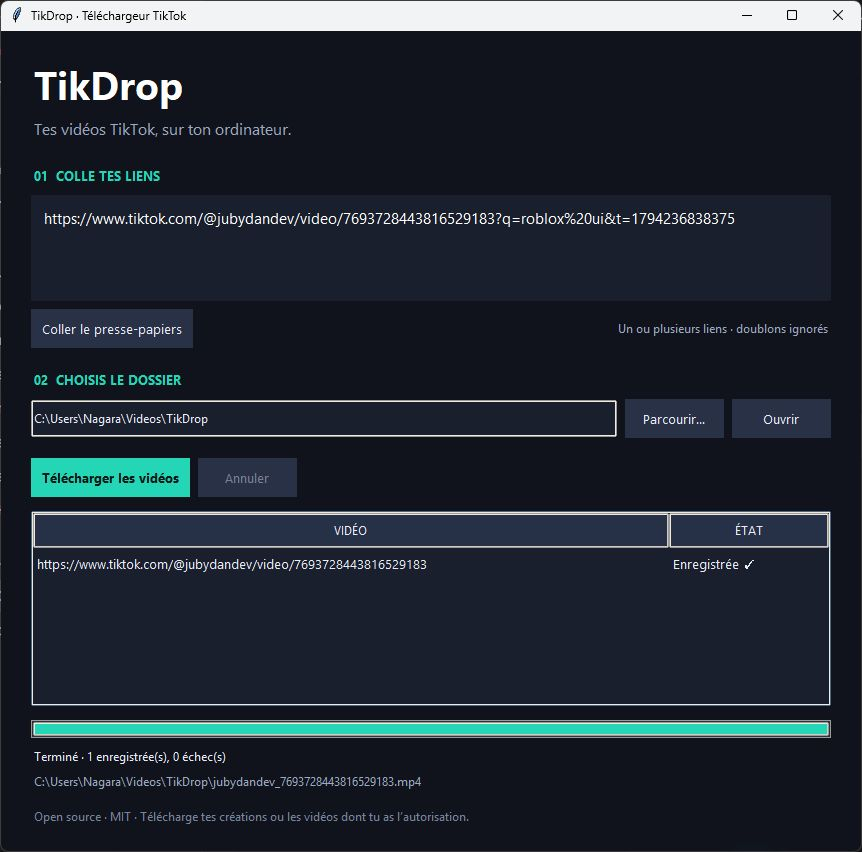

<div align="center">

# TikDrop

### Tes vidéos TikTok, sur ton ordinateur.

Une petite application Windows, gratuite et open source.<br>
Colle tes liens. Choisis ton dossier. Télécharge tes vidéos.

[](https://github.com/Nagaraaa/TikDrop/releases/latest)
[](#installation)
[](LICENSE)
[](#lancer-depuis-les-sources)

**Français** · [English](README.en.md)

**[Télécharger pour Windows](https://github.com/Nagaraaa/TikDrop/releases/latest/download/TikDrop-Windows.zip)** · [Toutes les versions](https://github.com/Nagaraaa/TikDrop/releases)



*Capture réelle de l’application après un téléchargement réussi.*

</div>

## Pourquoi TikDrop ?

| Fonction | Ce que tu peux faire |
| --- | --- |
| **Simple** | Coller un lien TikTok ou le texte complet d’un partage. Les liens qui ne sont pas des vidéos sont ignorés. |
| **Presse-papiers** | TikDrop repère un lien TikTok copié et propose de l’ajouter. |
| **Plusieurs vidéos** | Ajouter plusieurs liens et les télécharger à la suite. |
| **Ton dossier** | Choisir où enregistrer les vidéos ; TikDrop s’en souvient. |
| **Suivi en direct** | Voir l’auteur, le titre, la progression, le débit et le temps restant de chaque vidéo. |
| **Erreurs claires** | Comprendre en français pourquoi une vidéo échoue, puis réessayer seulement les échecs. |
| **Reprise** | Relancer un téléchargement partiel sans écraser les fichiers déjà présents. |
| **Portable** | Utiliser la version Windows sans installer Python ni FFmpeg. |

Pas de publicité, de télémétrie ajoutée ou de clé API à fournir. TikDrop ne demande ni mot de passe ni accès aux cookies de ton navigateur. Le téléchargement utilise le moteur open source [yt-dlp](https://github.com/yt-dlp/yt-dlp).

## Installation

### Windows — la méthode la plus simple

**Version Windows 64 bits, testée sur Windows 11.** Une connexion Internet est nécessaire.

1. Télécharge **[TikDrop-Windows.zip](https://github.com/Nagaraaa/TikDrop/releases/latest/download/TikDrop-Windows.zip)**.
2. Fais un clic droit sur l’archive, puis choisis **Extraire tout…**.
3. Ouvre le dossier extrait **TikDrop**.
4. Double-clique sur **TikDrop.exe**.

C’est prêt : aucune commande à saisir et aucune installation de Python nécessaire.

> **Garde tout le dossier.** Le dossier `_internal` doit rester à côté de `TikDrop.exe`. Ne lance pas l’application directement depuis le ZIP. L’exécutable de cette première version n’est pas signé numériquement.

```text
TikDrop/
├── TikDrop.exe       ← lancer ce fichier
├── _internal/        ← nécessaire au fonctionnement
├── licenses/
└── README.md
```

## Utilisation

1. Sur TikTok, copie le lien d’une vidéo via **Partager → Copier le lien**.
2. Reviens dans TikDrop : clique sur **Ajouter** dans le bandeau vert, sur **Coller**, ou colle directement le texte.
3. Pour plusieurs vidéos, ajoute un lien par ligne.
4. Choisis ton dossier avec **Changer…** (il est mémorisé pour la prochaine fois).
5. Clique sur **Télécharger** (ou Ctrl+Entrée) et attends l’état **Enregistrée ✓**.
6. Clique sur **Afficher** à côté d’une vidéo, ou sur **Ouvrir**, pour retrouver tes fichiers.

**Annuler** arrête le lot en cours ; **Réessayer** relance uniquement les vidéos en échec ou annulées. Un fichier `.part` peut rester dans le dossier : une nouvelle tentative peut le reprendre, ou tu peux le supprimer.

### Liens acceptés

```text
https://www.tiktok.com/@auteur/video/1234567890123456789
https://vm.tiktok.com/…
https://vt.tiktok.com/…
https://www.tiktok.com/t/…
```

Ces adresses illustrent les formats acceptés : utilise le vrai lien de ta vidéo. Les paramètres de partage sont retirés et les liens identiques sont dédupliqués. Les fichiers portent le nom de l’auteur et l’identifiant de la vidéo.

## Dépannage

| Problème | Que faire ? |
| --- | --- |
| L’application ne s’ouvre pas ou un fichier manque | Extrais **toute** l’archive et conserve `_internal` à côté de l’exécutable. |
| Le lien est refusé | Utilise le lien d’une vidéo individuelle, pas celui d’un profil ou d’un direct. |
| Erreur « IP blocked », « 403 » ou connexion obligatoire | Vérifie que la vidéo est publique et accessible dans ton navigateur. Réessaie plus tard et consulte les nouvelles versions de TikDrop. L’accès n’est pas garanti depuis tous les réseaux. |
| Un fichier `.part` est présent | Le téléchargement a été interrompu. Réessaie avec le même dossier pour tenter une reprise. |
| Une vidéo existante n’est pas remplacée | C’est prévu : les fichiers déjà présents ne sont pas écrasés. |

Un souci persiste ? [Ouvre une issue](https://github.com/Nagaraaa/TikDrop/issues) avec ta version de Windows, la version de TikDrop et le message d’erreur. Ne publie pas de mot de passe, cookie ou donnée privée.

## Lancer depuis les sources

**Prérequis : Python 3.10 ou plus récent avec Tkinter.** Environnement testé : Python 3.12 sur Windows. Internet est nécessaire pour installer les dépendances.

Télécharge les [sources depuis la release](https://github.com/Nagaraaa/TikDrop/releases/latest) ou clone le dépôt :

```powershell
git clone https://github.com/Nagaraaa/TikDrop.git
cd TikDrop
```

Sous Windows, ouvre **Lancer.cmd** : il crée un environnement Python local et installe les dépendances au premier lancement. Tu peux aussi utiliser PowerShell depuis le dossier des sources :

```powershell
py -3 -m venv .venv
.\.venv\Scripts\python.exe -m pip install -r requirements.txt
.\.venv\Scripts\python.exe app.py
```

<details>
<summary>Linux et macOS — lancement depuis les sources</summary>

La version portable fournie cible Windows. Le lancement sur Linux et macOS n’a pas été validé. Tkinter doit être disponible dans ton installation Python.

```sh
python3 -m venv .venv
.venv/bin/python -m pip install -r requirements.txt
.venv/bin/python app.py
```

</details>

## Développement

| Fichier | Rôle |
| --- | --- |
| `app.py` | Interface Tkinter et file de téléchargements. |
| `core.py` | Validation des liens et intégration de yt-dlp. |
| `test_core.py` | Tests du moteur avec des données simulées. |
| `assets/tikdrop.ico` | Icône de l’exécutable Windows. |
| `Construire.cmd` | Construction Windows avec PyInstaller. |
| `distribution/` | README livré dans le ZIP et script d’assemblage de l’archive. |
| `.github/` | Intégration continue (GitHub Actions) et Dependabot. |

Chaque vidéo est téléchargée dans un sous-processus pour garder l’interface réactive et permettre l’annulation. Le dossier choisi est enregistré dans `%APPDATA%\TikDrop\settings.json`.

**Lancer les tests :**

```powershell
.\.venv\Scripts\python.exe -m unittest -v
```

**Construire la version Windows :** ouvre `Construire.cmd`. Le résultat se trouve dans `dist\TikDrop`, et l’archive prête à distribuer dans `dist\TikDrop-Windows.zip`.

**Actualiser le moteur depuis les sources :**

```powershell
.\.venv\Scripts\python.exe -m pip install --upgrade yt-dlp curl-cffi
```

Pour distribuer cette mise à jour, actualise les versions dans `requirements.txt` et reconstruis l’application. La version portable ne se met pas à jour toute seule.

**Intégration continue :** à chaque pull request et sur `main`, GitHub Actions lance les tests (Python 3.12 et 3.14), construit l’exécutable avec `Construire.cmd`, vérifie qu’il démarre et charge le moteur, puis fournit `TikDrop-Windows.zip` en artefact. Dependabot propose chaque jour les nouvelles versions de yt-dlp et curl-cffi sous forme de pull request.

**Publier une version :** mets à jour `VERSION` dans `app.py` (et les versions dans `THIRD_PARTY.md` et `VERIFICATION.md`), puis pousse un tag `vX.Y.Z` correspondant. Un brouillon de release est créé avec `TikDrop-Windows.zip` et `TikDrop-Sources.zip` : complète les notes, puis publie-le.

## Périmètre et limites

- Vidéos publiques individuelles uniquement : pas de profils complets, directs ou diaporamas photo.
- Pas de contenu privé ni de contournement d’une connexion obligatoire.
- TikTok peut refuser l’accès selon la vidéo, le réseau, la région ou ses protections.
- Fichier audio/vidéo combiné, de préférence MP4, sans exiger FFmpeg.
- Résolution maximale parmi les pistes séparées et absence de filigrane non garanties. TikDrop n’ajoute aucun retrait de filigrane.
- Interface actuelle en français ; certains messages de yt-dlp sont en anglais.

Les essais (tests automatiques, téléchargements réels, exécutable Windows) et leurs limites sont documentés dans [VERIFICATION.md](VERIFICATION.md).

## Licence et crédits

TikDrop est sous [licence MIT](LICENSE). Les dépendances conservent leurs propres licences : voir [THIRD_PARTY.md](THIRD_PARTY.md).

Créé avec **Python**, **Tkinter**, **yt-dlp** et **curl-cffi**. Projet indépendant, sans affiliation avec TikTok.

Télécharge tes créations ou les contenus pour lesquels tu disposes des droits.
